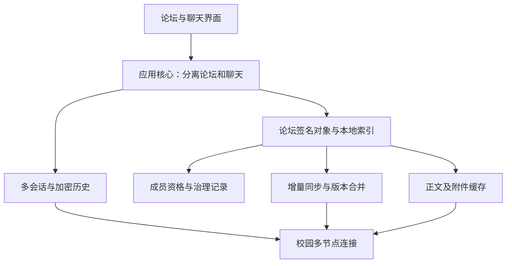

# SparkNet 校园论坛与多会话实施计划书 V1

日期：2026-11-09。状态：待用户审批，批准后才开始实现。本文件取代同日架构草案中不一致的编辑权限与同步描述。

## 1. 交付目标与边界

在当前 spark-chat 上交付校园成员论坛、多节点连接、多聊天会话和图片粘贴/内联预览。管理员离线、作者离线或网络分区后，其他在线成员仍能使用已有副本并继续发布；重连自动补齐和合并。

保留原双人端到端加密聊天、历史与普通文件流程。论坛与私聊入口分离，论坛不能自动发起私聊。论坛中所有有效且有发言权的成员可以修改共享主题及回复正文；修改必须独立署名，不冒充原作者。网站/论坛所有者管理配置和授权，普通内容编辑权不等于所有权或管理权。

一期不做：匿名/洋葱传输、STUN/打洞/中继、自动 DNS 发现、公链/代币、多人治理共识、任意可执行网站、群聊、无限附件、后台全盘文件共享。不开启公网发现，不扫描校园网。

网络发现使用当前连接码和缓存入口；校园断电后若旧地址全失效，需要人工取得新入口。之后研究 DNS，不建立唯一论坛主服务器。

## 2. 当前基线与数据保护

计划编写时 HEAD：d133d48d7f55736a7c81ae36dd798a72fd2f0362。实现开始前重新检查分支、工作区及构建状态。当前未跟踪的用户图片不移动、不提交；现有计划文档单独管理。

已核对：net.rs 只有单个 peer；多种命令/事件不含会话归属；web/app.js 为单联系人和全局附件状态。因此多节点不能只改网络连接数量。

先复核交接中的 vault nonce 重用风险、异常 X25519 输入、钥匙文件防覆盖问题；仍存在则作为单独安全修复处理，成熟密码库优先，不自制密码协议。迁移先备份、保留旧数据读取，失败不覆盖旧库或钥匙。不收集或提交私钥、测试身份、口令、签名材料。

## 3. 总体结构

连接层继续使用 libp2p/Noise 与 mpsc；所有线上共享类型集中定义在 protocol.rs。新增独立版本协议和经批准的新增接口；不改变旧帧语义和原 AppHooks 方法签名。论坛资格只限制论坛服务，不把既有独立聊天强制变成论坛账号功能。

每节点独立验证资格、签名、操作权限、对象完整性和资源限制。提供副本的节点不因此获得作者身份或编辑权限。

## 4. 身份、治理与隐私

- 管理者批准绑定公钥的邀请，记录邀请者与批准者；成员私钥仅留本机。初始可信管理公钥通过可信创始配置交付。
- 吊销成员公钥在本网络中的资格，只能由当前治理状态明确授权的管理员发起，并由该管理员本人持有的管理私钥签署。吊销记录绑定网络标识、目标公钥、操作类型、治理序号及前序记录；接收节点同时验证签名与签发者当时的管理权限，不能仅凭“签名有效”执行。
- 普通成员、邀请者、内容作者、论坛编辑者与缓存节点均无网络公钥吊销权；多数节点表态、内容编辑、举报或转发不能代替管理员签名。网站/版块管理权不自动等于网络管理员权限。管理私钥不分发给其他节点。
- 管理员签署后可由任意节点原样转发；转发者身份不构成吊销依据。管理员此后离线不影响有效记录的验证和传播。管理员离线且没有已签署记录时，其他节点不能代签或自动产生全网吊销。
- 本机因限流、异常数据或连接故障而拒绝某连接，只是本机连接策略，不生成全网吊销记录。管理员自身权限变更必须另按可信治理规则处理，不能依据普通成员声明更换管理公钥。
- 公钥签名证明该密钥授权的操作，不证明现实身份或内容真实。
- 治理记录一期采用单管理签发者、递增序号和前序引用；管理员离线不阻塞普通内容操作。治理分叉被检测后暂停受影响的授权判断，不凭时间选分支。
- 邀请链与公钥轮换留痕；邀请人撤销不自动连坐后代。无完整恢复依据时不提供冒认身份的人工捷径。
- 论坛对象、快照不携带原始上传 IP。不提供作者查 IP、全网地址导出或从论坛发起私聊。
- 直连接收者仍可能关联签名、认证身份与 IP；来源模糊不等于匿名。日志避免把业务对象与远端地址组成常规可导出的对应表，但不承诺抵御恶意节点记录。
- 本地私钥、草稿、索引和缓存采用成熟静态加密方案；不把本地加密称为论坛端到端保密。一期已批准成员能读取论坛内容，不引入动态群密钥，不保证撤销后收回旧副本。

## 5. 签名对象与索引

签名元数据包括协议用途/版本、网络/论坛标识、作者、操作、目标、父版本引用、正文哈希、附件清单和大小。使用无歧义的确定性编码及成熟签名/哈希库；对输入长度、类型、计数和跨网络重放设验证。

对象不可变；编辑新增对象，引用前一版。多父引用用于合并。个人签名原始记录保留，自动生成的合并视图不伪装为成员签署的新帖子。

所有成员最终同步完整轻量索引及验证依据，按页/增量补齐，不必阻塞到全量完成才能浏览。正文、图片、附件独立按哈希获取；索引可见不代表副本可达。快照是启动加速，不作为未经验证的事实源。权限、治理与当前版本所需的证据不得随普通附件缓存淘汰。

普通成员可以修改共享内容，但不能改写他人署名、批准身份、转移论坛所有权或签发管理隐藏操作。主题显示创建者与最新修改者，并可查看版本差异。

## 6. 网络分区与自动合并

重连顺序：交换治理头和内容头 → 拉取缺失记录 → 补齐父依赖 → 验证 → 更新版本图 → 确定性重建索引 → 按需取得正文。缺父记录先隔离待补齐，限制数量、深度、字节和重试，不提前当有效对象广播。

| 情形 | 行为 |
|---|---|
| 新主题、新回复 | 并集保留，按对象 ID 去重 |
| 单链后继 | 依因果引用前进，不按时间覆盖 |
| 并发不重叠文本编辑 | 仅恰好两个分支且有唯一共同基线时，用成熟三方合并库产生确定性视图；固定算法与版本 |
| 重叠修改、合并基准不明确、复杂多头 | 保留全部分支，稳定显示冲突，不随机选胜者 |
| 成员解决冲突 | 发布签名多父记录；旧分支证据保留 |
| 附件增删并发 | 可明确证明独立的操作合并；同一附件引用的冲突保留，不无条件集合并集 |
| 管理隐藏与普通编辑 | 有效管理隐藏作用于目标主题/记录的可见性，普通编辑不能绕过；恢复由有权管理者发布 |

同一有效记录集合必须产生相同版本头、索引和冲突状态，与收到顺序无关。单调时间戳不作为授权或冲突胜负依据。自动化目标是补齐、去重、收敛和呈现冲突，不虚称能判断矛盾文本的正确语义。

撤销采用明确保守规则：管理者可签署内容检查点，确认其已验证的记录集合（可通过哈希根及证明表达）。管理员离线时普通内容照常传播展示，不逐帖等待批准。撤销到达后，被撤销者已包含在有效检查点中的历史保留；未包含的记录及依赖影响进入争议状态，保留证据但不自动充当权威当前版本，管理者恢复在线后可签署明确处置。该规则可能隔离合法的离线编辑，但不依赖可伪造的客户端时间；界面必须解释原因。若实现评估需要改变该产品取舍，先提交修订计划，不能静默放宽。

## 7. 内容查询、缓存与带宽

本地查找 → 最近成功提供者 → 少量邻居有限转问。起始建议：3 个邻居、2 跳、5 秒一轮；请求编号去重，限制请求和响应总量，不提供完整缓存清单。不把无结果当全网不存在。直连不可达则尝试可用方向或其他副本，不暗中启用中继。

完整下载校验后原子提交，才回应可提供。发布区分仅本地、其他节点确认保存、附件仍待复制。尽量取得至少一个外部完整副本；失败保留待同步状态，不能宣称持久可用。

| 资源 | 初始值 |
|---|---|
| 论坛单附件 | 20 MB（十进制） |
| 每次发布附件 | 最多 5 个，总计 30 MB |
| 图片聊天自动预览接收 | 5 MB、20 百万像素以内；超限按文件处理 |
| 桌面普通缓存 | 1 GB，容量可调；自发及主动保留内容独立处理 |
| 移动端普通缓存 | 256 MB，前台在线提供服务，不承诺后台常驻 |
| 后台论坛发送总限速 | 5 Mbps，每节点总量而非每连接；聊天优先 |
| 后台文件发送并发 | 2 个，超出排队并可取消 |

论坛附件上限不重新限制既有普通聊天的大文件能力。索引同步也计入资源预算，保留独立的小型治理与控制消息额度。缓存空间不足可拒绝接收，不能清理用户导出目录。正文/缩略图/附件均通过认证授权，不因知道哈希而开放。

## 8. 多会话与图片

每个聊天拥有独立消息、草稿、历史、密钥状态、附件与进度。路由键包含对端、连接代次、方向与编号，不能靠当前选中页面路由异步消息。切换会话不关闭其他连接；一端断开不清空其他会话。锁定关闭所有业务连接并释放明文和密钥。

图片粘贴仅响应用户事件：Ctrl+V / Cmd+V → 待发送缩略图 → 用户发送；支持取消、文字粘贴及说明文字。发送动作绑定明确会话，切换联系人不得误发。

接收图片必须有新协议能力协商，检测真实格式并限制解码资源；静态 PNG/JPEG/WebP 优先，禁止 SVG/HTML 执行。受控内存或加密应用缓存生成预览，不要求先导出文件；页面只拿受限资源引用，不拿任意磁盘路径或密钥。旧客户端回退明确的普通文件流程。

图片与论坛 UI 共享可复用的显示部件但不共享私聊附件到论坛缓存；私聊图片绝不能成为论坛可查询对象。

Android 的选择、保存、查看继续使用原生授权，Activity 重建恢复会话和预览入口；进程死亡恢复单独记录支持范围。

## 9. 界面与操作闭环

论坛参考 Discourse：版块/主题列表、顺序回复、引用、编辑器、版本历史及冲突入口。聊天沿用 Telegram Desktop/Android，系统 CJK 字体，手机单列、40px 头像和48px触控目标。首批版块由管理者创建。

提供：主题、回复、人人署名编辑、版本差异、冲突解决、图片/文件、简单标题及已缓存正文搜索、草稿、举报、管理隐藏/锁定及成员审批。首版不加等级积分和推荐算法。

外链只显示可点击地址，由系统浏览器打开；不自动抓取预览或外链图片。用户输入按不可信内容渲染，不执行 HTML/脚本。浏览器不能从远程内容取得原生文件或密钥权限。

状态必须分清：缓存可读、同步中、缺依赖、缺在线副本、仅本机发布、已复制、版本冲突、成员资格过期/撤销。失败保留输入；重复提交使用确定对象标识避免重复发布。

## 10. 多 Agent 并发安排与批次

最多同时 4 个 Agent：主 Agent 负责共享契约、集成和验收，3 个工作 Agent 各自在独立 worktree/分支。默认沿用当前模型；不因提速擅自升级模型或额外服务。

### 阶段 P0：串行冻结共享契约

主 Agent 核对基线、建立集成分支，完成协议/存储迁移方案和最小失败回滚路径。安全 Agent 复核 vault；UI Agent 产出静态参考样式；同步 Agent 完成确定性数据结构测试设计。先集成共享类型和测试夹具，再开始依赖它们的实现。

### 阶段 P1：三路并行

| 工作线 | 文件责任 | 可独立验收产物 |
|---|---|---|
| A：论坛内核 | 新增论坛对象、索引、治理、合并模块及测试 | 签名验证、分区合并、撤销争议状态 |
| B：连接与聊天 | net/app 会话核心及相关测试 | 多节点、多会话、附件隔离 |
| C：界面与图片部件 | 独立前端部件、粘贴编辑器、预览及替身测试 | 参考 UI、粘贴、预览、冲突页面 |

protocol.rs、ui.rs、desktop.rs、共享入口文件只允许主 Agent 或明确指定的唯一负责人修改。前端与后端共享 app.js/app.rs 的最终接线由主 Agent 顺序集成，不允许并发覆盖。

### 阶段 P2：依赖就绪后并行

- A 实现有限发现、增量同步与内容获取，接入论坛内核。
- B 接入图片传输、能力协商和加密缓存，覆盖 Android 原生边界。
- C 接入论坛页面、草稿、管理与版本历史；补真实可用状态。
- 主 Agent 负责共同带宽预算、资源隔离及组合验证。

### 阶段 P3：审查、修复、最终产物

工作槽改为功能审查、安全审查和跨端验收；不得用同一实现者的自述替代独立检查。触发可用的仓库原生 Code Review/Security Review，记录实际覆盖 SHA；若不可用明确记录，不称通过。修复后复查受影响路径。

每个可独立测试/回滚功能建立 codex/ 分支和小 PR，面向集成分支；新增+删除目标不超过1000行，超出先说明并拆解，生成文件计入。不并行修改同一 worktree。用户审批计划允许实现、测试、隔离分支、提交及配置仓库内的草稿 PR；不构成发布、合主或覆盖用户正在使用客户端的授权。examples/headless_host.rs、tests/net_e2e.rs、tests/ui-check.js、Android Request 分支与界面恢复快照纳入调用者适配清单。

批次拆分建议：安全修复 → 新协议与会话标识 → 多会话核心 → 会话 UI → 图片发送 → 图片接收预览 → 论坛对象/治理 → 版本合并 → 索引同步 → 对象查询/缓存 → 论坛 UI → 管理与冲突 UI → 组合交付。依赖决定并发，不能用同时开工替代接口约定。

## 11. 必须通过的验收

1. 旧聊天回归：原有身份解锁、历史读取、双向文字和文件、空文件及大文件；旧客户端兼容或明确拒绝新功能。
2. 多会话：A 同时与 B/C 双向发消息和文件；编号重复、切换、重连、锁定均不串会话。
3. 图片：截图粘贴、取消、发送、直接预览、另存为、非法格式/像素炸弹/超限、旧端回退、页面重建。
4. 准入：伪造/过期/撤销凭证、未批准成员、跨网络重放、附件及缩略图越权均被拒绝。吊销专项覆盖普通成员有效签名仍被拒、冒用管理员被拒、无相应管理权限的签发者被拒、管理员有效签署后由第三方转发仍生效，以及管理员离线时普通节点不能自行吊销。
5. 签名与版本：篡改对象被拒；所有成员可署名编辑；并发冲突证据完整，普通编辑不能覆盖管理权限。
6. 分区：至少6个节点拆成3组，管理员离线，各自创建和编辑；按不同顺序重连、重复/乱序投递、同步中断后恢复，最终相同有效记录集合产生一致索引与冲突状态。
7. 撤销：分区期间编辑、撤销后重连、检查点内外历史、依赖争议及治理分叉行为符合规则，不按自报时间放行。
8. 可用性：管理员下线仍发帖；作者下线有副本仍可读；无副本明确提示；全员IP变更后新入口可恢复。
9. 资源：15 Mbps 约束环境，多个附件与聊天并行；后台总量不越预算，超额排队、缓存淘汰与未完成清理正确。
10. 界面/平台：系统中文、键盘、手机安全区与软键盘、Android文件授权和重建；模拟器与实体设备分别记录。

确定性测试与实际安装包测试分开。交付包含源码SHA、安装包哈希、截图、执行命令与结果、未测项、最短用户验收步骤和恢复办法。没有设备则如实标未测，不伪造跨端通过。

## 12. 审批范围与剩余边界

批准本计划即允许按以上默认值、依赖顺序、多 Agent 隔离并发方式实施并产生候选版本；关键规则变化再提出具体修订。完成后由用户验收，未经确认不合主、不发布。

已知边界：初次碰头需要当前入口；所有副本离线则内容不可读；撤销不是瞬时全网生效；分叉语义不能自动猜对；签名不证明内容真实；直连可暴露身份与IP；本地缓存加密不能让已授权成员忘掉读过的内容。

提速方式是先冻结契约、并行独立模块、早跑多节点测试；不以跳过安全验证、数据迁移或真实产物验收换速度。不在未执行前承诺完成日期或测试结果。
